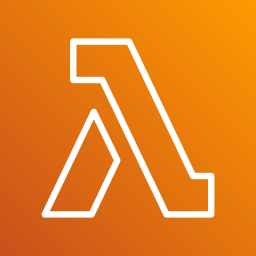

  
  &nbsp;
  
  &nbsp;
  

## About Me

<ul>
  <li>Year 3 at NTU's <strong>Renaissance Engineering Programme</strong></li>
  <li>B.Eng. in Computer Science + M.Sc. in Technology Management (Graduating <strong>Dec 2028</strong>)</li>
  <li>Currently: Year-Long Exchange in <strong>UC Berkeley</strong></li>
  <li>Previously: Data Engineering at <strong>Rakuten Viki</strong></li>
</ul>

## Featured Work
<table>
  <tr>
    <td width="50%" valign="top">
      
<a href="https://github.com/MT7654/Our-Grandparents-Shoes">ConverseBetter</a>

      
Conversation-training platform that helps youth volunteers practise empathetic communication with elderly seniors.

    </td>
    <td width="50%" valign="top">
      
<a href="https://github.com/qorkjnxdk/Edufinder">EduFinder</a>

      
AI-powered school search and comparison platform with real-time government data and personalised recommendations.

    </td>
  </tr>
  <tr>
    <td width="50%" valign="top">
      
<a href="https://github.com/qorkjnxdk/DBFromScratch">DB From Scratch</a>

      
Learning more about database internals.

    </td>
    <td width="50%" valign="top">
      
<a href="https://github.com/NHS172k3/agentic-dating">Agentic Dating</a>

      
Controlled profile-evaluation simulator using computer-use agents to model synthetic dating-app personas.

    </td>
  </tr>
</table>

## Skills

### Languages

  

### Frameworks

  
  &nbsp;
  

### Tools

  

### Cloud

  
  
  &nbsp;
  
  &nbsp;
  

## Currently Working On

- [ ] Project about Database Internals  
- [ ] Learn about Distributed Systems

<!-- SPOTIFY:START -->
### Listening To

<table>
<tr><td>01</td><td></td><td><a href="https://open.spotify.com/track/2P4OICZRVAQcYAV2JReRfj">Waiting For Love</a> Avicii</td></tr>
<tr><td>02</td><td></td><td><a href="https://open.spotify.com/track/3UN6cIn3VIyg0z1LCuFSum">Without You (feat. Usher)</a> David Guetta, USHER</td></tr>
<tr><td>03</td><td></td><td><a href="https://open.spotify.com/track/3eR23VReFzcdmS7TYCrhCe">It Ain&#x27;t Me (with Selena Gomez)</a> Kygo, Selena Gomez</td></tr>
<tr><td>04</td><td></td><td><a href="https://open.spotify.com/track/0oF9jpn0n8afMpbHKgRd6J">I Ain&#x27;t Worried</a> OneRepublic</td></tr>
<tr><td>05</td><td></td><td><a href="https://open.spotify.com/track/3ScJy88F8KqGDfWu8XJhHx">If I Lose Myself - Alesso vs OneRepublic</a> OneRepublic, Alesso</td></tr>
</table>
<!-- SPOTIFY:END -->
